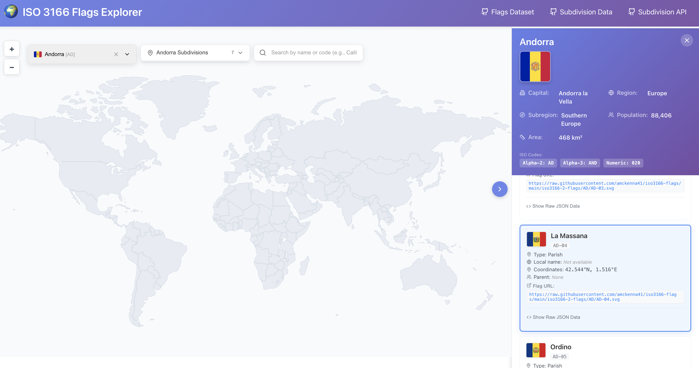

# 🌍 ISO 3166 Flags Explorer

An interactive map for exploring countries and their administrative subdivisions (regions/states) with comprehensive country and regional flags and detailed information sourced from the ISO 3166 standard. All data sourced from the custom-built [iso3166-flags](https://github.com/iso3166-flags) dataset and repository.

Visit the ISO 3166 Flags Explorer here:
> https://github.com/iso3166-flags

 

## Features

- **Interactive World Map**: Explore countries and regions with an interactive map interface. Zoom, pan, and click to learn more about countries and regions.
- **Rich Subdivision Data**: Access comprehensive information about over 5,000 administrative subdivisions including flags, local names, precise coordinates, parent codes, and historical change records from the ISO 3166-2 standard.
- **Comprehensive Flags**: Browse thousands of official flags for countries and their subdivisions sourced from the [ISO 3166 Flags Dataset](https://github.com/amckenna41/iso3166-flags).
- **Historical Updates**: Access historical information about changes to subdivision codes and naming conventions from the [ISO 3166 Updates Dataset](https://github.com/iso3166-updates).

## Data sources

- [ISO 3166 Flags Dataset](https://github.com/amckenna41/iso3166-flags) - Comprehensive flag imagery for countries and subdivisions
- [ISO 3166 Updates Dataset](https://github.com/iso3166-updates) - Historical changes to ISO 3166 codes and naming

## Configuration

All application configuration is centralized in [`src/config/appConfig.ts`](src/config/appConfig.ts). This eliminates the need for environment variables and makes configuration management simpler and more explicit.

**Key configuration values:**
- **API Endpoints**: ISO 3166-2 API and REST Countries API
- **Data Sources**: Flag repository URLs
- **External Links**: References to datasets and repositories

To modify API endpoints or data sources, edit the `src/config/appConfig.ts` file directly. No environment variables or `.env` file is required.
- [ISO 3166-2 Dataset](https://github.com/iso3166-2) - ISO 3166-2 subdivision data