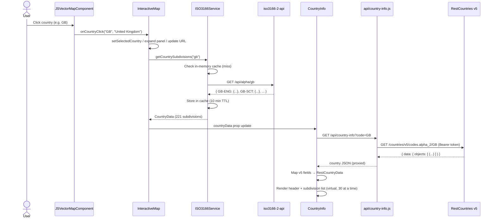
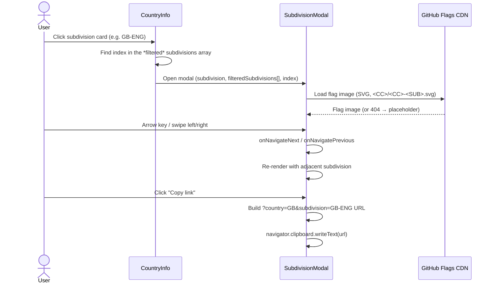

# Architecture Diagram

## System Overview

```mermaid
graph TB
    subgraph Browser["Browser"]
        subgraph SPA["React SPA"]
            App["App.tsx\n(root)"]
            EBD["ErrorBoundary\nWraps app · map · info panel\ncomparison · about"]

            subgraph Orchestrator["State Orchestrator"]
                IM["InteractiveMap.tsx\nHolds all app state\nURL ↔ state sync"]
            end

            subgraph UILayer["UI Layer"]
                AH["AppHeader\nBranding · Nav links · Compare · About"]
                CC["CountryComparison\nUp to 4 countries side by side\nCSV / JSON export"]
                AM["AboutModal\nProject info dialog\nEscape · Focus trap"]
                JVM["JSVectorMapComponent\njsvectormap world map\nClick · Hover · Zoom/pan\nMiller / Mercator projection"]
                CD["CountryDropdown\nFavourites · Recents · Search"]
                SD["SubdivisionDropdown\nFiltered by selected country"]
                SC["SearchComponent\nGlobal subdivision search\n300 ms debounce"]

                subgraph InfoPanel["Info Panel (right)"]
                    CI["CountryInfo\nCountry header · Flag · Stats\nFilter · Sort · Virtual list"]
                    EB["ExportButton\nCSV / JSON export"]
                    SM["SubdivisionModal\nFull detail · Swipe · Keyboard nav\nCopy code · Share link"]
                    DI["DemoInfo\nProject info — empty state\nand About dialog body"]
                end
            end

            subgraph ServiceLayer["Service & Util Layer"]
                SVC["ISO3166Service\nAxios · 10 min in-memory cache\nIn-flight de-duplication\nRequest timeout 15 s"]
                CFG["appConfig.ts\nFeature flags · Env vars · URLs"]
                EXP["exportUtils.ts\nCSV / JSON formatters\nFormula-injection escaping"]
                ERR["errorHandler.ts\nUser-facing error messages"]
                CTRY["data/countries.ts\nISO 3166-1 list (249)\nresolveCountry(alpha-2/3/name)"]
                UST["utils/urlState.ts\nMerge · validate query params"]
                STO["utils/storage.ts\nShape-validated localStorage"]
                ULR["utils/useLatestRequest.ts\nOut-of-order response guard"]
                DOMU["utils/dom.ts\nscrollIntoView guard"]
            end

            subgraph Persistence["Browser Persistence"]
                LS1["localStorage\niso3166_favourite_countries"]
                LS2["localStorage\niso3166_recent_countries"]
                URL["URL query params\n?country=GB&subdivision=GB-ENG\n&filter=&type=&sort="]
                SW["service-worker.ts (workbox)\nPrecached app shell\nFlags: CacheFirst 30 d\nSubdivisions: SWR 7 d"]
            end
        end
    end

    subgraph VercelCloud["Vercel (Production)"]
        CDN["Static CDN Edge\nReact build output"]
        FN["api/country-info.js\nVercel Serverless Function\nHolds REST_COUNTRIES_API_KEY"]
    end

    subgraph DevEnvironment["Local Dev (CRA)"]
        PROXY["setupProxy.js\nExpress middleware\nMirrors Vercel function"]
    end

    subgraph ExternalServices["External Services"]
        ISO_API["iso3166-2-api.vercel.app\nISO 3166-2 subdivision data\nName · Type · Coords · History"]
        RC_API["api.restcountries.com/countries/v5\nCountry info\nCapital · Population · TLD · etc."]
        FLAGS_CDN["raw.githubusercontent.com\namckenna41/iso3166-flags\nSVG & PNG flag images"]
    end

    subgraph CICD["CI / CD"]
        GH["GitHub Actions\nUnit tests · Build on push/PR"]
        VD["Vercel Deploy\nAuto-deploy on main push"]
    end

    %% Component tree
    App --> EBD
    EBD --> IM
    IM --> CC
    IM --> AM
    IM --> AH
    IM --> JVM
    IM --> CD
    IM --> SD
    IM --> SC
    IM --> CI
    CI --> EB
    CI --> SM
    CI --> DI
    AM --> DI

    %% Service wiring
    IM -->|getCountrySubdivisions| SVC
    CC -->|getCountryInfo| SVC
    CC -->|formatCountryForExport| EXP
    CI -->|getCountryInfo| SVC
    IM -->|resolveCountry| CTRY
    CD -->|country list · alpha-3 match| CTRY
    IM -->|merge · validate| UST
    CI -->|merge · validate| UST
    IM -->|discard stale responses| ULR
    CI -->|discard stale responses| ULR
    SC -->|discard stale responses| ULR
    SC -->|searchSubdivisions| SVC
    SD -->|getCountrySubdivisions| SVC
    SVC -->|GET /api/alpha/:code| ISO_API
    SVC -->|GET /api/search/:term| ISO_API
    SVC -->|flag URL| FLAGS_CDN
    SVC -->|GET /api/country-info| FN
    SVC -.->|dev only: GET /api/country-info| PROXY
    FN -->|Bearer token| RC_API
    PROXY -.->|Bearer token| RC_API

    %% Persistence
    CD <-->|read / write via storage.ts| LS2
    CI <-->|read / write via storage.ts| LS1
    CD <-->|read| LS1
    IM <-->|country · subdivision| URL
    CI <-->|filter · type · sort| URL
    SW -.->|cached responses| ISO_API
    SW -.->|cached images| FLAGS_CDN

    %% Deployment
    GH -->|on pass| VD
    VD --> CDN
    VD --> FN
```

---

## Data Flow: Country Selection

---

## Data Flow: Subdivision Modal

---

## Key Design Decisions

| Decision | Rationale |
|---|---|
| API key in Vercel Serverless Function | `REST_COUNTRIES_API_KEY` never reaches the browser bundle — not prefixed `REACT_APP_` |
| CRA `setupProxy.js` mirrors Vercel function | Local dev has the same request path as production — no `localhost:PORT` hardcoding |
| In-memory cache with 10 min TTL | Avoids redundant API calls when the user revisits a country in the same session |
| URL query params for state | Subdivisions and countries are deep-linkable without a router library |
| `CustomEvent` for favourite sync | `CountryInfo` and `CountryDropdown` stay decoupled — no prop drilling through `InteractiveMap` |
| `IntersectionObserver` for virtual list | Renders 30 cards at a time — avoids blocking the main thread with 221 DOM nodes (UK) |
| `Array.isArray()` guards on v5 API fields | The RestCountries v5 response structure is inconsistent across countries |
| Merged (not replaced) query string | `InteractiveMap` owns `country`/`subdivision` while `CountryInfo` owns `filter`/`type`/`sort`. `mergeUrlState()` means the last writer no longer clobbers the other's params |
| Token-based staleness check, not `AbortSignal` | Requests are shared and cached in `ISO3166Service`, so one caller aborting would cancel it for everyone. `useLatestRequest` discards superseded responses instead |
| In-flight de-duplication in the service | Two components reacting to the same click both miss the cache in the same tick; without it they fire duplicate requests |
| Shape validation on every `localStorage` read | `JSON.parse` succeeding does not mean the value has the expected shape — a tampered entry parses fine and then throws on `.map()` mid-render |
| CSS `!important` for map selection, not polling | jsvectormap re-applies inline fill/stroke on hover. A CSS rule outranks inline styles, replacing a 100 ms `setInterval` repaint loop with an attribute toggle |
| Error boundaries per region, not just at the root | A throw in the map, info panel or comparison leaves the rest of the app usable, with a local "Try again" |
| Workbox service worker, production only | Flags and subdivision data are near-immutable, so caching them is a genuine win; registering in dev would serve stale bundles. Dev additionally *unregisters* any worker left behind by a local production build, which would otherwise serve precached chunks to the dev server |
| Region leave detected from the DOM | jsvectormap exposes no region-out callback (only `onRegionClick`, `onRegionSelected`, `onRegionTooltipShow`); its internal `mouseout` handling hides the built-in tooltip and emits nothing, so `mousemove`/`mouseleave` listeners on the canvas drive the custom tooltip's dismissal |
| Selecting a country does not move the viewport | Highlight only — an auto-zoom fought the user's own zoom and pan, and re-centred the map on every dropdown pick |
| Projection switch rebuilds the map instance | jsvectormap cannot swap map data in place. The rebuild re-applies the current highlight, and React overlays live outside the container the setup wipes with `innerHTML = ''` |
