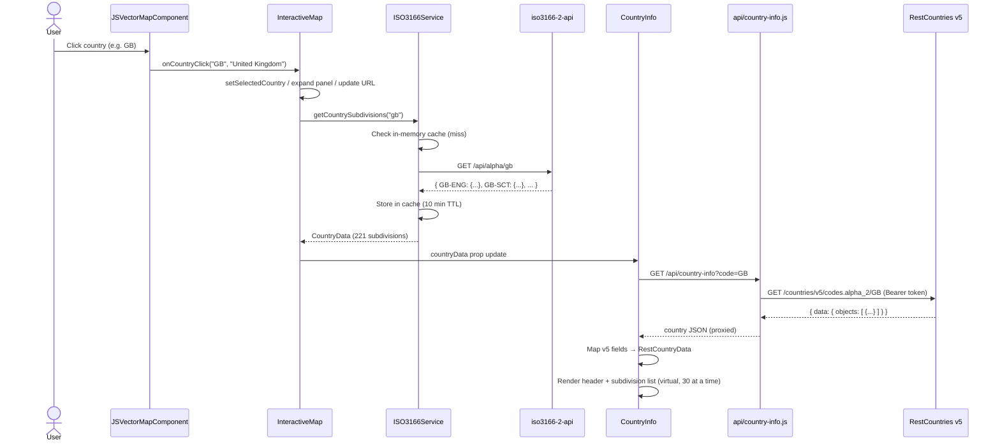
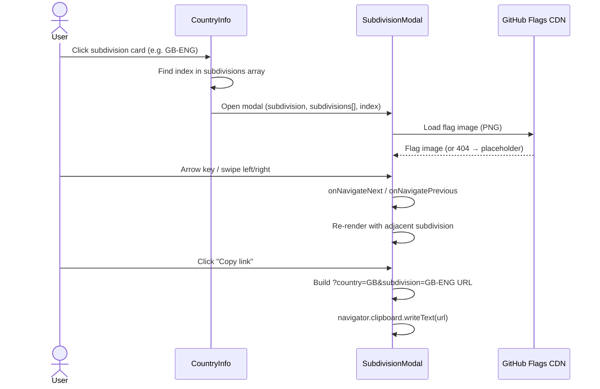

# Architecture Diagram

## System Overview

```mermaid
graph TB
    subgraph Browser["Browser"]
        subgraph SPA["React SPA"]
            App["App.tsx\n(root)"]

            subgraph Orchestrator["State Orchestrator"]
                IM["InteractiveMap.tsx\nHolds all app state\nURL ↔ state sync"]
            end

            subgraph UILayer["UI Layer"]
                AH["AppHeader\nBranding · Nav links"]
                JVM["JSVectorMapComponent\njsvectormap world map\nClick · Hover · Auto-zoom"]
                CD["CountryDropdown\nFavourites · Recents · Search"]
                SD["SubdivisionDropdown\nFiltered by selected country"]
                SC["SearchComponent\nGlobal subdivision search\n300 ms debounce"]

                subgraph InfoPanel["Info Panel (right)"]
                    CI["CountryInfo\nCountry header · Flag · Stats\nFilter · Sort · Virtual list"]
                    EB["ExportButton\nCSV / JSON export"]
                    SM["SubdivisionModal\nFull detail · Swipe · Keyboard nav\nCopy code · Share link"]
                    DI["DemoInfo\nWelcome / empty state"]
                end
            end

            subgraph ServiceLayer["Service & Util Layer"]
                SVC["ISO3166Service\nAxios · 10 min in-memory cache\nRequest timeout 15 s"]
                CFG["appConfig.ts\nFeature flags · Env vars · URLs"]
                EXP["exportUtils.ts\nCSV / JSON formatters"]
                ERR["errorHandler.ts\nUser-facing error messages"]
            end

            subgraph Persistence["Browser Persistence"]
                LS1["localStorage\niso3166_favourite_countries"]
                LS2["localStorage\niso3166_recent_countries"]
                URL["URL query params\n?country=GB&subdivision=GB-ENG"]
            end
        end
    end

    subgraph VercelCloud["Vercel (Production)"]
        CDN["Static CDN Edge\nReact build output"]
        FN["api/country-info.js\nVercel Serverless Function\nHolds REST_COUNTRIES_API_KEY"]
    end

    subgraph DevEnvironment["Local Dev (CRA)"]
        PROXY["setupProxy.js\nExpress middleware\nMirrors Vercel function"]
    end

    subgraph ExternalServices["External Services"]
        ISO_API["iso3166-2-api.vercel.app\nISO 3166-2 subdivision data\nName · Type · Coords · History"]
        RC_API["api.restcountries.com/countries/v5\nCountry info\nCapital · Population · TLD · etc."]
        FLAGS_CDN["raw.githubusercontent.com\namckenna41/iso3166-flags\nSVG & PNG flag images"]
    end

    subgraph CICD["CI / CD"]
        GH["GitHub Actions\nUnit tests · Build on push/PR"]
        VD["Vercel Deploy\nAuto-deploy on main push"]
    end

    %% Component tree
    App --> IM
    IM --> AH
    IM --> JVM
    IM --> CD
    IM --> SD
    IM --> SC
    IM --> CI
    CI --> EB
    CI --> SM
    CI --> DI

    %% Service wiring
    IM -->|getCountrySubdivisions| SVC
    CI -->|getCountryInfo| SVC
    SC -->|searchSubdivisions| SVC
    SD -->|getCountrySubdivisions| SVC
    SVC -->|GET /api/alpha/:code| ISO_API
    SVC -->|GET /api/search/:term| ISO_API
    SVC -->|flag URL| FLAGS_CDN
    SVC -->|GET /api/country-info| FN
    SVC -.->|dev only: GET /api/country-info| PROXY
    FN -->|Bearer token| RC_API
    PROXY -.->|Bearer token| RC_API

    %% Persistence
    CD <-->|read / write| LS2
    CI <-->|read / write| LS1
    CD <-->|read| LS1
    IM <-->|sync on mount + change| URL

    %% Deployment
    GH -->|on pass| VD
    VD --> CDN
    VD --> FN
```

---

## Data Flow: Country Selection

---

## Data Flow: Subdivision Modal

---

## Key Design Decisions

| Decision | Rationale |
|---|---|
| API key in Vercel Serverless Function | `REST_COUNTRIES_API_KEY` never reaches the browser bundle — not prefixed `REACT_APP_` |
| CRA `setupProxy.js` mirrors Vercel function | Local dev has the same request path as production — no `localhost:PORT` hardcoding |
| In-memory cache with 10 min TTL | Avoids redundant API calls when the user revisits a country in the same session |
| URL query params for state | Subdivisions and countries are deep-linkable without a router library |
| `CustomEvent` for favourite sync | `CountryInfo` and `CountryDropdown` stay decoupled — no prop drilling through `InteractiveMap` |
| `IntersectionObserver` for virtual list | Renders 30 cards at a time — avoids blocking the main thread with 221 DOM nodes (UK) |
| `Array.isArray()` guards on v5 API fields | The RestCountries v5 response structure is inconsistent across countries |
